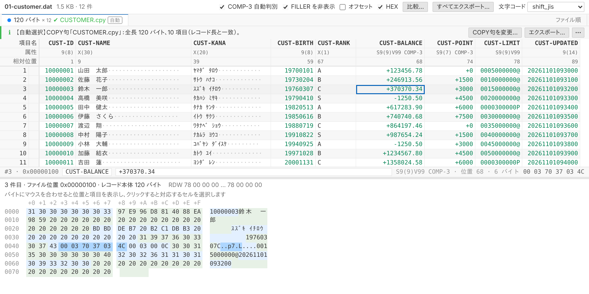

# RDW Viewer — COBOL Copybook Record Viewer for VS Code

[日本語](README.md) | English | [中文](README.zh-CN.md)

View, decode and compare **variable-length record files with RDW (Record Descriptor Word)** directly in VS Code.
Each record becomes one row, split into columns by your **COBOL copybook (COPY句)**, with COMP-3 / COMP / zoned decimal values decoded.



> The viewer's UI is in **Japanese** (default) or **Chinese** (when VS Code's display language is Chinese). This English page explains how to use it.

## Why RDW Viewer?

Batch data produced by COBOL programs is hard to read in a text editor: records have no line breaks, numbers are packed, and text is Shift_JIS. RDW Viewer lets you:

- **Read RDW files as a table** — one record per row, fields laid out by your copybook.
- **Parse COBOL copybooks** — `PIC`, `USAGE`, `OCCURS`, `REDEFINES`, `SYNC`, nested `COPY ... REPLACING`, fixed / variable / free format.
- **Compare two data files** — side by side, matched by record number or by key fields, with differences highlighted.

## Features

- **Copybook-based field layout**: pick a copybook per record length; if exactly one copybook in the workspace matches the length, it is used automatically. Choices are saved to `.vscode/rdw-viewer.json`.
- **Numeric decoding**: `COMP-3` / `PACKED-DECIMAL`, `COMP` / `COMP-4` / `BINARY`, `COMP-5`, `COMP-1` / `COMP-2` (IEEE or IBM hex float), zoned decimal (`DISPLAY`, `SIGN SEPARATE`). Invalid data is shown as hex, never as a plausible-looking number.
- **Mixed record layouts**: one tab per record length; switch copybooks by a field value (header / detail / trailer) when lengths are the same; switch `REDEFINES` layouts.
- **Two-file compare**: synced side-by-side tables, diff-only filter, next/previous diff (F7 / Shift+F7), excluded fields (e.g. timestamps), diff export to CSV / TSV.
- **Hex dump**: per-record hex view with field boundaries, linked to the table cells.
- **No copybook? Still useful**: COMP-3 values are auto-detected (heuristic, may be wrong) so you can inspect unknown files.
- **RDW error detection**: mismatched RDWs, invalid lengths and truncated files are reported with offsets, and parsing resyncs to the next valid record.
- **CSV / TSV export**: per tab or all tabs, Shift_JIS or UTF-8 with BOM.
- **Large files**: local files are read page by page instead of all at once, with progress and cancel.

## Supported file format

```text
[RDW 4 bytes][record body N bytes][RDW 4 bytes]
```

- The RDW is **little-endian**: the first 2 bytes hold the body length N; the last 2 bytes are ignored.
- A record is accepted when the leading and trailing RDWs match.
- The record body is decoded as **Shift_JIS** by default (`rdwViewer.encoding` accepts any WHATWG encoding name, such as `utf-8` or `euc-jp`).

Numeric decoding follows **Fujitsu NetCOBOL**'s internal representation by default. Mainframe data that has already been converted from EBCDIC can be read by switching `binaryEndian` / `comp5Endian` to `big` and `floatFormat` to `ibm`.

Not supported: the IBM z/OS RDW layout (big-endian, leading RDW only), raw EBCDIC text, and fixed-length files without RDW.

## Installation

- **VS Code**: open the Extensions view (`Ctrl+Shift+X`), search for **RDW Viewer**, and install `zhuuchaofan.rdw-viewer`.
- Or run in Quick Open (`Ctrl+P`): `ext install zhuuchaofan.rdw-viewer`
- **From source**: `npm install && npx vsce package`, then *Extensions: Install from VSIX...*

Requires VS Code 1.85 or later.

## Quick start

1. Open a folder containing your data files and copybooks.
2. In the Explorer, right-click a `.dat` / `.rdw` (or any) file → **RDW Viewer で開く** (*Open with RDW Viewer*).
3. Click **COPY句を選択…** (*Select copybook…*) above the tab and choose a copybook. Copybooks whose total length matches the record length are listed first with ✓.
4. Click a cell to see its offset, decoded value and raw bytes; toggle **HEX** for the record's hex dump.

To **compare** two files, select both in the Explorer, right-click → **RDW Viewer で比較** (*Compare with RDW Viewer*).

### Try the samples

The [`examples/`](examples/) folder contains ready-to-open RDW files and copybooks. Open the `examples` folder in VS Code (its `.vscode/rdw-viewer.json` is picked up automatically) and open any `.dat` file:

| File | What it shows |
| --- | --- |
| `01-customer.dat` | Japanese text, half-width kana, COMP-3, zoned decimal; fixed-format copybook |
| `02-mixed-length.dat` | Mixed record lengths: header 40 / detail 80 / trailer 30 bytes |
| `03-same-length.dat` | Same length (64), copybook chosen by record type in byte 1 |
| `04-redefines.dat` | `REDEFINES`: card / bank / cash layouts by payment type |
| `05-numeric.dat` | All numeric USAGEs, including invalid data |
| `06-broken.dat` | RDW errors: mismatch, bad length, truncated file |
| `07-no-copybook.dat` | No copybook: COMP-3 auto-detection |

## Settings

| Setting | Default | Description |
| --- | --- | --- |
| `rdwViewer.encoding` | `shift_jis` | Default encoding of the record body |
| `rdwViewer.lengthMismatch` | `lenient` | When record and copybook lengths differ: `lenient` splits as far as possible, `strict` shows the whole record |
| `rdwViewer.binaryEndian` | `big` | Byte order of `COMP` / `COMP-4` / `BINARY` |
| `rdwViewer.comp5Endian` | `little` | Byte order of `COMP-5` and `COMP-1` / `COMP-2` |
| `rdwViewer.floatFormat` | `ieee` | `COMP-1` / `COMP-2` format: `ieee` or `ibm` |
| `rdwViewer.autoDetectPacked` | `true` | Auto-detect COMP-3 when no copybook is set |
| `rdwViewer.exportEncoding` | `shift_jis` | Export encoding: `shift_jis` or `utf-8-bom` |
| `rdwViewer.hiddenFieldPattern` | `^FILLER$` | Regex of field names hidden by "Hide FILLER" |

## Limitations

- `OCCURS DEPENDING ON` is expanded to its maximum count, not the actual count.
- Copybook constructs the parser cannot interpret are **flagged, not silently skipped**: the header turns red (field positions may be wrong) or orange (numeric values may be wrong).
- COMP-3 auto-detection without a copybook is a guess; set a copybook for accurate results.

For the full reference (copybook coverage, numeric formats, compare and discriminator details), see the [Japanese](README.md) or [Chinese](README.zh-CN.md) documentation.

## Feedback

Bug reports and feature requests are welcome on [GitHub Issues](https://github.com/zhuuchaofan/vscode-rdw-viewer/issues). Sample files (with sensitive data removed) and the copybook help a lot.

## License

[MIT](LICENSE)
