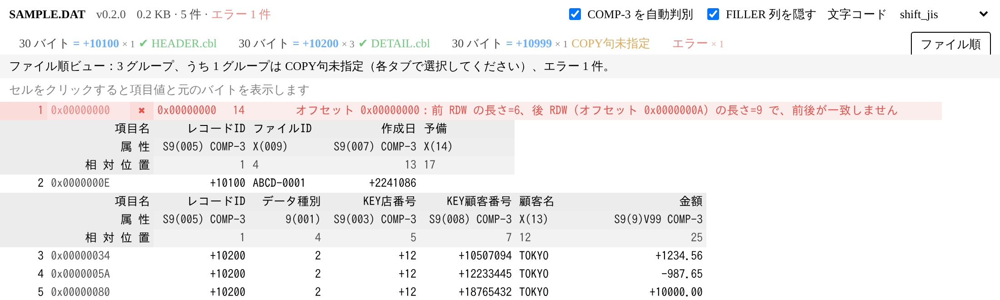

# RDW Viewer

日本語 | [中文](README.zh-CN.md)



**RDW（Record Descriptor Word）** 付きの可変長レコードファイルを VS Code で表示する拡張機能です。
1 レコードを 1 行とし、COBOL の COPY句に従って項目を横に並べて表示します。

## ファイル形式

```text
[前 RDW 4 バイト][レコード本体 N バイト][後 RDW 4 バイト]
```

- RDW はリトルエンディアン。先頭 2 バイトがレコード本体の長さ N、後半 2 バイトは使用しません（画面には表示しません）。
- 前後の RDW が一致することでレコード境界を判定します。
- レコード本体は既定で Shift_JIS としてデコードします。画面右上、または設定 `rdwViewer.encoding` で変更できます。

## 使い方

エクスプローラーでファイルを右クリック →「**RDW Viewer で開く**」。

- **レコード長ごとのタブ**：長さの異なるレコードが混在する場合、長さごとにタブを分け、それぞれに COPY句を指定できます。
- **COPY句の指定**：タブ上部の「COPY句を選択…」から選びます。全長がレコード長と一致する COPY句は ✓ 付きで先頭に表示されます。指定内容は `<ワークスペース>/.vscode/rdw-viewer.json` に保存され、次回から自動で適用されます。
- **ファイル順**：右上の「ファイル順」で、ファイル上の順序のまま全レコードを表示します。COPY句が切り替わる箇所には見出し（項目名 / 属性 / 相対位置）が挿入されます。
- **セルの詳細**：セルをクリックすると、表の上に項目値と元のバイト（16 進）を表示します。
- **エラー**：レコード長の超過、ファイルの途中切れ、前後 RDW の不一致は「エラー」タブとファイル順ビューに赤で表示し、オフセットと原因を示します。後続の正しいレコード境界を探して解析を続けます。
- **表示言語**：VS Code の表示言語に合わせて切り替わります（日本語環境では日本語、それ以外は中国語）。

### 同じレコード長で、項目値によって COPY句を切り替える

レコード長は同じでもレイアウトが異なる場合（ヘッダー・明細・トレーラーなど）、ある項目の値で区別できます。

1. 対象のレコード長のタブで「**項目値で切り替え…**」をクリックします。
2. 判別に使う項目を選びます。現在の COPY句の項目（例：`レコードID`）から選ぶか、開始位置・長さ・型（文字 / COMP-3）を手入力します。COMP-3 項目は数値として比較します。
3. その項目に現れる値と件数が一覧表示されます。確認すると値ごとにタブが作られます（例：「1600 バイト = +10200」）。
4. タブごとに COPY句を選択します。対応する COPY句がない値は別グループとなり、レコード全体を表示します。

値が 50 種類を超える場合は「項目の選択が誤っている可能性がある」として中止します。「切り替えを解除」でレコード長単位の表示に戻せます。
設定は `.vscode/rdw-viewer.json` の `discriminators` に保存されます。

```json
{
  "copybooks": { "2000": "copy/HEADER.cbl" },
  "discriminators": {
    "1600": {
      "start": 1, "length": 3, "type": "comp3",
      "copybooks": { "+10100": "copy/HEADER.cbl", "+10200": "copy/DETAIL.cbl" }
    }
  }
}
```

### COPY句がない場合：COMP-3 の自動判別

COPY句が未指定のレコードは「レコード全体」の 1 列で表示します。ツールバーの「**COMP-3 を自動判別**」がオンのとき（既定でオン、設定 `rdwViewer.autoDetectPacked`）、
レコードを文字・COMP-3・判別できないバイトに分けて表示します。

```text
[+10100]1ABCD-0001[+0][+0][+2241070][+2241086]
```

- `[ ]`（緑）：推定した COMP-3 の値。符号 C/D は `+`/`-` 付き、F は符号なし。小数点の位置は分からないため整数で表示します。
- `‹ ›`（灰色）：文字でも COMP-3 でもないバイト。16 進で表示します。
- 末尾の空白は表示しません。セルをクリックすると全内容と元のバイトを確認できます。

**推定のため誤判定の可能性があります。** たとえば文字の直後に 0x20（空白）で始まる COMP-3 が続く場合、その空白は文字の末尾として扱われます。
正確に表示するには COPY句を指定してください（指定後は自動判別しません）。

### レコード長と COPY句の長さが一致しない場合

| 状況 | lenient（既定） | strict |
| --- | --- | --- |
| レコードが COPY句より長い | 超過分を「(余り)」列にオレンジで表示 | 分割せずレコード全体を表示 |
| レコードが COPY句より短い | 途中で切れた項目はオレンジ、存在しない項目は `—` | 同上 |
| `PIC 9` 項目に数字以外がある、Shift_JIS としてデコードできない | そのまま表示してオレンジ | — |

設定 `rdwViewer.lengthMismatch` で切り替えます。長さが合わないときは「**解析詳細**」で各項目の位置・長さ・解析メモを一覧表示し、COPY句と見比べることができます。

### COPY句の対応範囲

- 固定形式 / 自由形式（行ごとに判定。1〜6 桁目の一連番号、73〜80 桁目の識別領域は自動で除去。一部の行の形式が崩れていても他の行に影響しません）
- レベル番号、`FILLER`、`PIC X/A/9/S/V/Z…`、`PIC N` / `PIC G`（1 文字 2 バイト）、`SIGN … SEPARATE`、`OCCURS n`（`name(1)…` に展開）
- `01` が複数ある場合は、全長がレコード長と一致するものを自動で使用
- `COMPUTATIONAL-3` などの正式名称

数値の USAGE は値にデコードして右寄せで表示します。

| USAGE | 表示 |
| --- | --- |
| `COMP-3` / `PACKED-DECIMAL` | 10 進数。`V` の位置に小数点を入れます（例：`PIC S9(5)V99 COMP-3` の `12 34 56 7C` → `+12345.67`）。不正なバイトは 16 進でオレンジ表示 |
| `COMP` / `BINARY` / `COMP-4` / `COMP-5` | 2 進整数。バイト順は `rdwViewer.binaryEndian`（既定 big） |
| `COMP-1` / `COMP-2` | 4 / 8 バイト浮動小数点 |

未対応（メモを表示します）：`REDEFINES`（無視し、領域を占有しません）、`OCCURS DEPENDING ON`（最大回数で展開）。

## 設定

| 設定 | 既定値 | 説明 |
| --- | --- | --- |
| `rdwViewer.encoding` | `shift_jis` | 既定の文字コード |
| `rdwViewer.lengthMismatch` | `lenient` | 長さ不一致時の扱い |
| `rdwViewer.binaryEndian` | `big` | `COMP` / `BINARY` 項目のバイト順（COMP-3 には影響しません） |
| `rdwViewer.autoDetectPacked` | `true` | COPY句がない場合に COMP-3 を自動判別 |
| `rdwViewer.hiddenFieldPattern` | `^FILLER$` | 「FILLER 列を隠す」で隠す項目名の正規表現（例：`FILLER\|COMMA`） |

## 開発

```bash
npm install     # 初回のみ：TypeScript などの開発用依存関係をインストール
npm test        # コンパイルして単体テストを実行
npm run compile # コンパイルのみ
```

vsix の作成（自動でコンパイルされます）：

```bash
npx vsce package
```

## ライセンス

[MIT](LICENSE)
