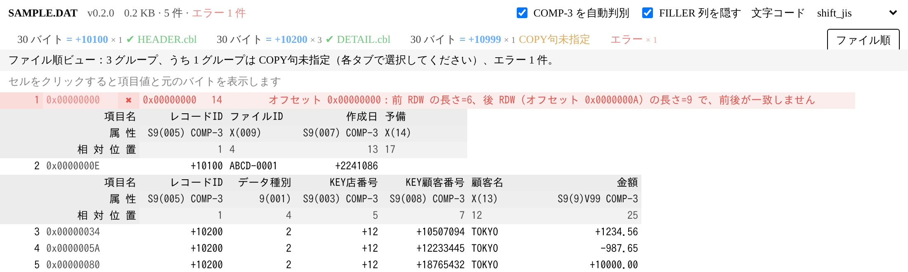

# RDW Viewer

[日本語](README.md) | 中文



查看带 **RDW（Record Descriptor Word）** 的可变长记录文件的 VS Code 插件。每条记录一行，按 COBOL copybook 把字段横向展开显示。

## 文件格式

```text
[前置 RDW 4B][记录正文 N 字节][后置 RDW 4B]
```

- RDW 为小端序，前 2 字节 = 正文长度 N，后 2 字节不使用（界面不显示）。
- 前后 RDW 必须一致，据此识别记录边界。
- 正文默认按 Shift_JIS 解码，可在界面右上角切换编码，或通过设置 `rdwViewer.encoding` 修改默认值。

## 使用

在资源管理器中右键文件 → **用 RDW Viewer 打开**。

- **按长度分组**：同一文件里有多种长度的记录时，每种长度一个标签页，各自对应一个 copybook。
- **选择 copybook**：在标签页上方点「选择 copybook…」。工作区里总长度与记录长度一致的 `.cpy` 会排在最前面并带 ✓。选择结果保存到 `<工作区>/.vscode/rdw-viewer.json`（无工作区时保存到全局状态），下次打开自动应用。
- **文件顺序**：右上角「文件顺序」按原始顺序混排所有记录，copybook 切换处插入新的三行表头（項目名 / 属性 / 相対位置）。
- **版本**：工具栏文件名旁显示当前运行的插件版本。
- **界面语言**：按 VS Code 的显示语言自动切换，日文环境显示日文，其他环境显示中文。
- **单元格详情**：点击单元格，在表格上方显示字段值和原始字节（十六进制）。
- **错误**：长度越界、文件截断、前后 RDW 不一致都会在「错误」标签页和文件顺序视图中标红，写明偏移和原因，并尝试从后面的有效记录重新对齐。

### 同一长度、按字段值使用不同 copybook

记录长度相同但布局不同（例如头记录、明细记录、尾记录），可以按某个字段的值区分：

1. 在该长度的标签页上方点「**按字段值区分…**」。
2. 选择判别字段：可以直接选当前 copybook 中的字段（如 `レコードID`，COMP-3 字段会自动按数值比较），也可以手动输入起始位置、长度和类型（文字 / COMP-3）。
3. 插件列出该字段上出现的所有值及记录数，确认后每个值成为一个标签页，例如「1600 字节 = +10200」。
4. 在各标签页分别选择 copybook。没有对应 copybook 的值单独成组，显示整条正文。

判别字段的取值超过 50 种时会提示「可能选错了字段」并取消。点「取消区分」可恢复为按长度分组。
设置保存在 `.vscode/rdw-viewer.json` 的 `discriminators` 中：

```json
{
  "copybooks": { "2000": "copy/HEADER.cbl" },
  "discriminators": {
    "1600": {
      "start": 1, "length": 3, "type": "comp3",
      "copybooks": { "+10100": "copy/HEADER.cbl", "+10200": "copy/DETAIL.cbl" }
    }
  }
}
```

### 没有 copybook 时：自动识别 COMP-3

尚未指定 copybook 的记录显示为「整条正文」一列。工具栏的「**自动识别 COMP-3**」开启时（默认开启，设置 `rdwViewer.autoDetectPacked`），
会把正文切分成文字、COMP-3、无法识别的字节三类：

```text
[+10100]1ABCD-0001[+0][+0][+2241070][+2241086]
```

- `[ ]`（绿色）：猜测出的 COMP-3 数值。C/D 结尾带 `+`/`-`，F 结尾不带符号；不知道小数位，按整数显示。
- `‹ ›`（灰色）：既不是文字也不是 COMP-3 的字节，以十六进制显示。
- 末尾空格不显示；点击单元格可在上方查看完整内容和原始字节。

这是**启发式猜测，可能误判**。例如文字后面紧跟以 `0x20`（空格）开头的 COMP-3 时，这个空格会被当作文字末尾的空格。
需要准确结果时请指定 copybook；指定后不再自动识别。

### 长度与 copybook 不一致

| 情况 | 宽松模式（默认） | 严格模式 |
| --- | --- | --- |
| 正文比 copybook 长 | 多出的字节显示在「(余り)」列，标橙 | 不拆分，只显示整条正文 |
| 正文比 copybook 短 | 被截断的字段标橙，缺失字段显示 `—` | 同上 |
| `PIC 9` 字段含非数字、SJIS 解码失败 | 原样显示并标橙 | — |

通过 `rdwViewer.lengthMismatch` 切换模式。

### copybook 支持范围

支持：
- 固定/自由格式（逐行判断；1~6 列序号、73~80 列标识自动去除，个别行格式不规整不影响其他行）
- 层级号、`FILLER`、`PIC X/A/9/S/V/Z…`、`PIC N` / `PIC G`（每字符 2 字节）、`SIGN … SEPARATE`、`OCCURS n`（展开为 `name(1)…`）
- 多个 `01`：自动选用总长度等于记录长度的那个定义
- `COMPUTATIONAL-3` 等全称写法

数值类 USAGE 会解码成可读的数值（右对齐显示，点击单元格可看原始字节）：

| USAGE | 显示 |
| --- | --- |
| `COMP-3` / `PACKED-DECIMAL` | 十进制数，按 `V` 位置插入小数点，如 `PIC S9(5)V99 COMP-3` 的 `12 34 56 7C` → `+12345.67`。符号半字节 C/F/A/E 为正、D/B 为负；数字或符号半字节非法时回退为十六进制并标橙 |
| `COMP` / `BINARY` / `COMP-4` / `COMP-5` | 定点二进制整数，字节序由 `rdwViewer.binaryEndian` 决定（默认 big） |
| `COMP-1` / `COMP-2` | 4 / 8 字节浮点数 |

有符号字段显示 `+` / `-`，无符号字段不带符号。

不支持（会给出提示）：`REDEFINES`（忽略，不占位置）、`OCCURS DEPENDING ON`（按最大次数展开）。

copybook 总长度与记录长度对不上时，点提示条上的「**解析详情**」，会在编辑器中列出每个字段的位置、长度、属性以及解析提示，方便对照 copybook 原文找出差异。

## 设置

| 设置 | 默认 | 说明 |
| --- | --- | --- |
| `rdwViewer.encoding` | `shift_jis` | 默认字符编码 |
| `rdwViewer.lengthMismatch` | `lenient` | 长度不一致时的处理方式 |
| `rdwViewer.binaryEndian` | `big` | `COMP` / `BINARY` 字段的字节序（COMP-3 不受影响） |
| `rdwViewer.autoDetectPacked` | `true` | 没有 copybook 时自动识别 COMP-3 |
| `rdwViewer.hiddenFieldPattern` | `^FILLER$` | 「隐藏 FILLER 列」开关隐藏的字段名正则，如 `FILLER\|COMMA` |

## 发布

发布到 VS Code Marketplace 和 Open VSX 的步骤见 [PUBLISHING.md](PUBLISHING.md)。

## 开发

```bash
npm install     # 首次必须执行：安装 TypeScript 等开发依赖
npm test        # 编译并运行单元测试
npm run compile # 仅编译
```

打包成 vsix（会自动先编译）：

```bash
npx vsce package
```

按 F5 启动 Extension Development Host 调试。

目录结构：

- `src/rdw.ts` RDW 扫描与错误恢复
- `src/copybook.ts` copybook 解析
- `src/layout.ts` 列布局（长度不一致的处理）
- `src/i18n.ts` 界面文字（中文 / 日文）
- `src/autodetect.ts` 无 copybook 时的 COMP-3 自动识别
- `src/numeric.ts` COMP-3 / COMP 解码
- `src/session.ts` 数据模型（分组、按需解码、虚拟滚动数据源）
- `src/extension.ts` VS Code 集成（命令、webview、copybook 映射存储）
- `media/` webview 前端（虚拟滚动表格）

以上模块中除 `extension.ts` 外都不依赖 VS Code，测试直接用 `node --test` 运行。
